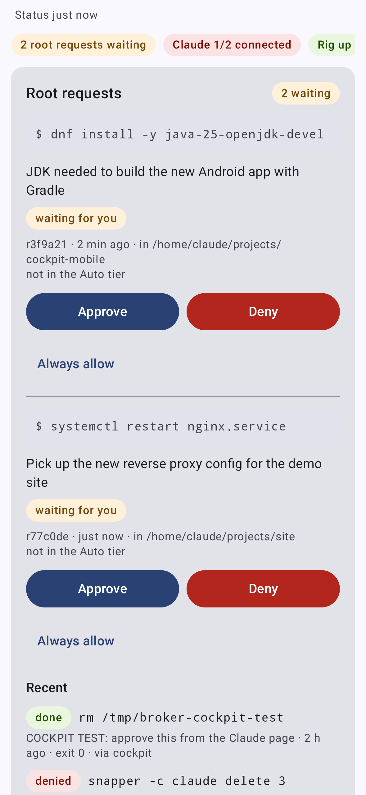
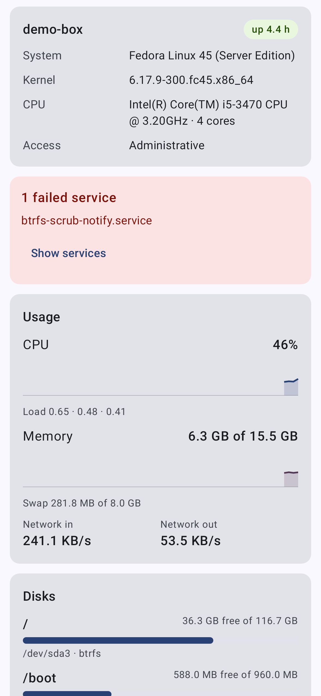
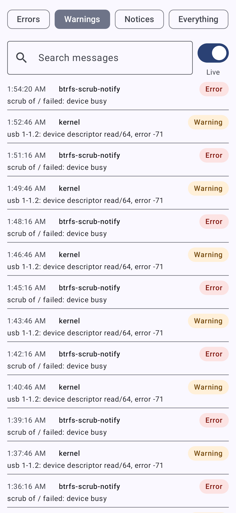
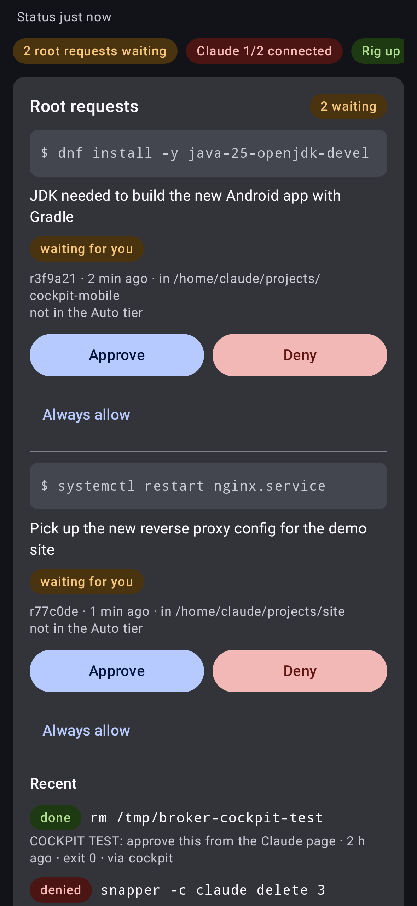

# Cockpit Mobile

A phone app for [Cockpit](https://cockpit-project.org/) hosts, built for one hand and a small screen. It speaks
Cockpit's own protocol, so logins, permissions and admin access behave exactly like the web UI, and nothing has to be
installed on the server.

<p>




</p>

## What it does

- **Overview**: OS, kernel, CPU, uptime; live CPU, memory, swap, load and network; disks; failed services; restart and shut down.
- **Claude page (our mod)**: a native screen for `/usr/share/cockpit/claude` with every panel of the web page:
  root requests (Approve / Deny / Always allow), sessions (reconnect RC, restart, new session, restart all), branches
  and PRs with CI checks, the main rig (wake, suspend, power off), storage (cargo-sweep, Podman prune), snapshots and
  the activity feed. It reads the same status files and runs the same `claude-ctl` commands through admin access, so the
  phone and the web page always agree. The tab only appears on hosts that have the package.
- **Notifications**: root requests waiting for approval, with **Approve / Deny on the notification** (the phone must be
  unlocked), plus Claude sessions down and disk ≥ 90 %. Checked every 15 minutes (Android's minimum) and when you leave the app.
- **System**: services (filter, start/stop/restart, enable/disable, status), the journal (priority, unit, search, live),
  Podman containers (yours and, with admin access, root's; start/stop/restart, logs), software updates, Cockpit's own
  terminal, and "run a command" (optionally as root).
- **Every Cockpit page, mods included**: the Pages tab lists everything in Cockpit's `manifests.json` and opens it in the
  app with your login, with mobile tweaks. Add-on and custom packages show up by themselves and are labelled *mod*.
- **Several hosts**, switchable from the title bar. Admin access can be switched on and off like the web's
  "Limited access" button. Optional app lock (fingerprint, face or screen lock).

## Security

- Passwords are encrypted with a key held by the Android Keystore; the app keeps no other copy.
- TLS: publicly trusted certificates (e.g. Tailscale's) work as usual. Cockpit's self-signed certificate is shown with its
  SHA-256 fingerprint on first connect and pinned; a changed certificate is refused with a clear warning.
- Approve / Deny on notifications require the phone to be unlocked.

## Connecting

Use the address you use in the browser, e.g. `optiplex.tailnet.ts.net` (Tailscale serve, port 443) or
`192.168.1.10` (port 9090 is added). Cockpit checks the WebSocket's origin: if you set `Origins` in
`/etc/cockpit/cockpit.conf`, the address you use in the app must be in that list (the app says so if it isn't).

## Build

Needs JDK 17+ and the Android SDK (platform 37).

```sh
./gradlew testDebugUnitTest lintDebug   # checks
./gradlew assembleRelease               # app/build/outputs/apk/release/app-release.apk (debug-key signed, for sideloading)
```

`tools/emulator.sh` boots a headless emulator (no display needed), installs the debug build and starts it;
`tools/emulator.sh shot NAME` saves a screenshot. It uses `-gpu lavapipe` because the emulator's default software GPU
crashes on some older CPUs.

Debug builds have a **demo host** (a pretend Cockpit inside the app) on the first screen, to try everything without a server.

Tests:

- protocol tests against a fake `cockpit-ws`, and against the real `cockpit-bridge` when it's installed;
- parsers fed with real `/proc`, `df`, `systemctl` and `journalctl` output of the build machine;
- `SHOTS=1 ./gradlew testDebugUnitTest --tests '*ScreenshotTest*'` renders every screen against the demo host into
  `app/build/shots/` and checks that tapping Approve moves a request to Recent;
- `COCKPIT_E2E_URL=https://host:9090 COCKPIT_E2E_USER=… COCKPIT_E2E_PASSWORD=… ./gradlew testDebugUnitTest --tests '*EndToEnd*'`
  runs against a real Cockpit.
